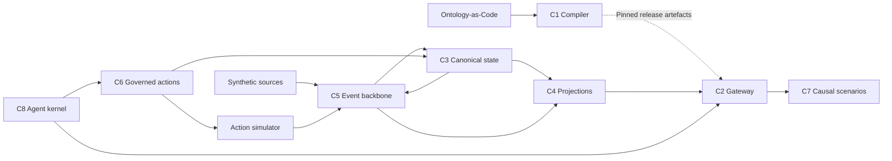

# OCOR

OCOR is a sovereign, vendor-neutral semantic and operational core. It connects
ontology definitions, evidence, governed decisions and controlled actions so that
software and agents can work against explicit contracts and authority boundaries.
Its proof of concept uses a wholly synthetic national resilience scenario, including
power continuity and its cyber, telecommunications, information and supply-chain
dependencies. External sources and action targets are simulators.

This repository contains the approved design, implementation, development method
and evidence history. This README is an orientation guide. If it conflicts with a
normative source, that source prevails under the
[RCCAD precedence rules](docs/development_methodology/OCOR_RCCAD_v1.0.md).
Start with the [approved ADD v1.3](ocor-runtime/docs/governance_dossier/OCOR_ADD_v1.3_APPROVED_BASELINE.md)
and [approved LLD v1.1](docs/OCOR_LLD_v1.1.md) for the system's actual obligations.

## Purpose and boundaries

OCOR keeps definitions, asserted state, derived projections, decisions and observed
outcomes distinct. A query, simulation or agent proposal does not itself authorise
an action or change canonical state. Policy, identity, human approval where required,
version fences and audit accompany governed operations.

The PoC is a bounded synthetic exercise. Its design approval and development test
results do not establish runtime conformance, compliance, performance equivalence,
parity, superiority or Production readiness. The
[ADD](ocor-runtime/docs/governance_dossier/OCOR_ADD_v1.3_APPROVED_BASELINE.md)
defines these boundaries; the [LLD](docs/OCOR_LLD_v1.1.md) describes their implementation contracts.

## The eight subsystems

The following descriptions summarise responsibilities, rather than deployment or
completion status. The authoritative decomposition is in ADD §2 and LLD §2.

| Subsystem | Responsibility |
| --- | --- |
| C1 — Ontology Compiler & IR Pipeline | Compiles Ontology-as-Code into signed, versioned Canonical IR and derived contracts and artefacts. |
| C2 — Unified Semantic Gateway | Serves typed named queries with policy filtering, provenance and explicit consistency information. |
| C3 — Canonical State Service & Outbox Worker | Commits authorised state changes with revision, idempotency and outbox invariants. |
| C4 — Projection Adapters | Maintains rebuildable read projections and their watermarks; projections do not become canonical authority. |
| C5 — Event Backbone | Carries ingestion, commit and execution events with durable delivery, deduplication and replay. |
| C6 — Action Engine & Saga Coordinator | Governs action workflows, approvals, execution, compensation and reconciliation. |
| C7 — Causal Runtime & Scenario Orchestrator | Runs pinned causal models and isolated scenarios, with explicit abstention when evidence is insufficient. |
| C8 — Agent Kernel & Governed Tool Runtime | Bounds agent activity through governed queries, typed tools, delegation and leases. |

C1 supplies release artefacts to the runtime. C5 brings admitted inputs to C3 and
propagates committed events to C4. C2 reads the projections; C8 uses C2 and governed
tools. C7 evaluates scenarios without implicitly committing them. C6 governs action
and canonical mutation paths; action receipts return through the event flow.
Identity, policy, authority and audit are cross-cutting controls.

The diagram is a simplified interaction map; it omits individual ports and controls.
See the [ADD container view](ocor-runtime/docs/governance_dossier/OCOR_ADD_v1.3_APPROVED_BASELINE.md)
and [LLD component design](docs/OCOR_LLD_v1.1.md) for complete flows and failure semantics.

## Metamodel in brief

Ontology-as-Code is the authoritative definition source. C1 compiles it into
Canonical IR; backend artefacts derive from that IR. Stores do not regenerate the
source. Definitions describe types, links, constraints, mappings and named
query, function, model, action and tool contracts.

At runtime, claims and observations retain source and provenance; evidence supports
decisions, and authority bounds the actions those decisions can permit. The Governed
Context Set binds the relevant identity, policy, release and execution context.
Marking, tenant and compartment boundaries constrain information flow. Governed
memory has its own admission, versioning, retrieval, lifecycle and deletion duties;
agent output does not bypass C6 and C3 to become canonical truth.

These are summaries of
[ADD §3 and its full-memory amendment](ocor-runtime/docs/governance_dossier/OCOR_ADD_v1.3_APPROVED_BASELINE.md)
and [LLD §1–§2](docs/OCOR_LLD_v1.1.md). Consult the
[requirement register](ocor-runtime/docs/governance_dossier/registers/OCOR_Requirement_Register_v1.1_APPROVED.md)
for obligations and the [normative contracts](ocor-runtime/docs/governance_dossier/contracts)
for exact structures; this guide does not reproduce them.

## Governance and evidence

[RCCAD](docs/development_methodology/OCOR_RCCAD_v1.0.md) means Risk-Driven,
Contract-First, Continuous-Assurance Development. Work proceeds through G0–G7:
planning and foundations, contracts, risk spikes, a vertical slice, component
implementation, governed memory, qualification campaigns and a decision package.
The [development plan](docs/development_plan/OCOR_AI_FIRST_DEVELOPMENT_PLAN.md)
and [backlog](docs/development_plan/OCOR_IMPLEMENTATION_BACKLOG.json) define gate
entry and exit criteria. The [Definition of Done](docs/development_methodology/OCOR_DEFINITION_OF_DONE.md)
requires executable criteria, traceability, applicable real-service tests and independent review.

Approved decisions are recorded in the
[decision register](ocor-runtime/docs/governance_dossier/registers/OCOR_Decision_Register_v1.6_APPROVED.md)
and [ARA decision records](ocor-runtime/docs/governance_dossier).
Remediation corrects a scoped defect through review and new evidence. Supersession
keeps sealed records available as history; it does not rewrite their results.
Open requests and remediation dispositions are tracked in the
[execution state](reports/development/EXECUTION_STATE.json).

As read on **24 October 2026**, the evidence fence remains `E1=0`, `E2=0`, with zero
globally `Verified` requirements; runtime conformance is `NOT_ESTABLISHED` and
PoC-GO and Production readiness remain `NO-GO`. Read the current `claims` in the
[execution state](reports/development/EXECUTION_STATE.json), together with the
[ADD evidence fence](ocor-runtime/docs/governance_dossier/OCOR_ADD_v1.3_APPROVED_BASELINE.md),
for the current disposition. Localised historical evidence is limited to its
recorded scope and does not lift that fence.

## Repository map

The [authority dossier](ocor-runtime/docs/governance_dossier) and
[methodology manifest](docs/development_methodology/methodology.json) establish
which sources govern the implementation. In particular, `inputs/` remains immutable
material under review; its presence does not override later approved supersessions.

| Location | Contents and interpretation |
| --- | --- |
| [Governance dossier](ocor-runtime/docs/governance_dossier) | Approved composite baselines, ARA records, contracts, registers and authority checksums. Read their document-control and supersession clauses. |
| [LLD v1.1](docs/OCOR_LLD_v1.1.md) | Approved low-level design linked to ADD v1.3. |
| [Development methodology](docs/development_methodology) and [plan](docs/development_plan) | Governing method, language and tooling policies, backlog, dependencies and traceability. |
| [Inputs](inputs) | Immutable review sources and supporting material, including historical context. |
| [Runtime](ocor-runtime) | Implementation, tests, generated SDKs and build configuration; code does not override approved semantics. |
| [Infrastructure](infra) and [deployment](deploy) | Pinned tool/service locks and disposable development and PoC deployment definitions. |
| [Scripts](scripts) and [CI workflows](.github/workflows) | Reproducible validators, qualification tools and required checks. |
| [Development state](reports/development) | Current execution state, handoff, iteration history, blockers and decision requests. |
| [Evidence](reports/evidence) and [assurance](reports/assurance) | Candidate and sealed records, manifests, raw results, independent review and explicit supersession. Read status and scope before using a record. |
| [Reports](reports), [planning reports](reports/planning) and [spikes](spikes) | Review history, planning snapshots and bounded experiments. Historical findings and spike results do not establish current qualification. |

## Verification and current status

The verification entry points are:

- `sha256sum -c inputs/normative/SHA256SUMS` checks the immutable review inputs.
- [`scripts/verify.py`](scripts/verify.py) checks document and contract mechanics,
  including schema validation and reference resolution. It writes a report and
  does not establish behavioural conformance.
- [`scripts/validate_evidence_input_drift.py`](scripts/validate_evidence_input_drift.py)
  compares the latest completed-task evidence inputs with the current files.
- [CI](.github/workflows) runs required contract, runtime, policy, supply-chain,
  evidence and methodology checks. Qualifying campaigns require the selected real
  backends, positive and negative cases, exact test accounting and zero skips.

The [test strategy](docs/development_methodology/OCOR_TEST_STRATEGY.md) specifies
which techniques and backends qualify evidence. A mechanical PASS alone does not
close a gate or establish a system claim.

Read the [execution state](reports/development/EXECUTION_STATE.json) for current
completion, blockers and the next executable action; the
[model handoff](reports/development/MODEL_HANDOFF.json) for the precise checkpoint;
and the [iteration log](reports/development/ITERATION_LOG.md) for recorded history.
Progress figures are deliberately kept in those files. People and agents working
in this repository must follow [AGENTS.md](AGENTS.md) and any applicable nested
instructions.

## Glossary

The terminology below follows the
[ADD](ocor-runtime/docs/governance_dossier/OCOR_ADD_v1.3_APPROVED_BASELINE.md),
[LLD](docs/OCOR_LLD_v1.1.md) and [methodology](docs/development_methodology/methodology.json).

| Term | Meaning |
| --- | --- |
| ADD / LLD | Architectural Design Document / Low-Level Design. |
| IRB | Initial Requirements Baseline. |
| OaC / IR | Ontology-as-Code / Intermediate Representation; Canonical IR is the compiled semantic definition. |
| GCS | Governed Context Set, binding the context used for governed execution. |
| ARA / PO | Architecture Review Authority / Product Owner. |
| DEC / REM | Recorded architectural decision / scoped remediation work item. |
| RCCAD | Risk-Driven, Contract-First, Continuous-Assurance Development. |
| G0–G7 | Development and qualification gates defined by the approved plan. |
| BA / FGM | Backend-assumption campaigns / full-governed-memory campaigns. |
| FSM / Saga | Finite State Machine / coordinated workflow with recovery and compensation. |
| MCP / SDK | Model Context Protocol / Software Development Kit. |
| CI / PoC | Continuous integration / proof of concept. In ADD tables, `CI` can instead mean Candidate Implementation. |
| E1 / E2 / Verified | Governed evidence and requirement-verification designations, constrained by the evidence fence. |
